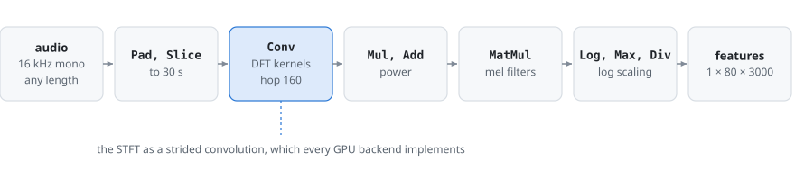
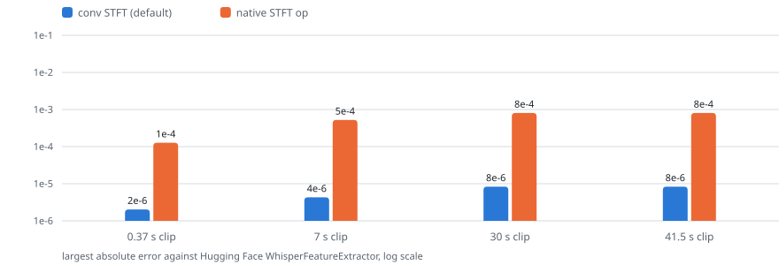
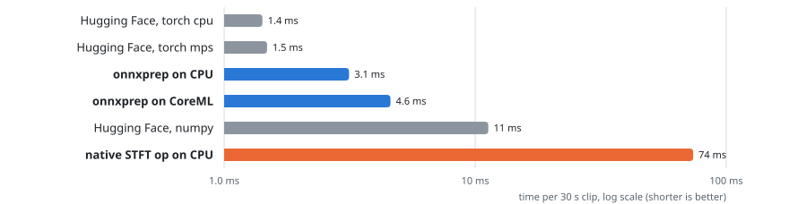

# onnxprep

onnxprep builds the steps around a model as plain ONNX graphs, so they ship in the same kind of file as
the model and run wherever it runs. The first recipe is Whisper's audio front end. It turns raw 16 kHz
samples into the log-mel features the encoder expects, as a 0.7 MB file built from standard operators only.

<picture>
  <source media="(prefers-color-scheme: dark)" srcset="docs/img/pipeline-dark.svg">
  
</picture>

## Why

Shipping a speech model to a browser, a phone or an edge box usually means exporting the network to ONNX
and then rewriting the preprocessing by hand in whatever language the app uses. Whisper's front end alone
has been ported to JavaScript, Rust, Swift and C++, many times over. Each port is a chance to get the
padding, the window or the log scaling slightly wrong. Nothing crashes. The transcripts just get a bit
worse, and nobody notices.

ONNX already has the operators to express this. If the preprocessing is a graph, the app passes in
microphone samples and gets back exactly what the model was trained on, on any runtime: onnxruntime on
CPU, CUDA, CoreML or DirectML, or onnxruntime-web in a browser tab.

## How well it works

**Accuracy.** Across clips from 0.37 s to 41.5 s, the output matches Hugging Face's
`WhisperFeatureExtractor`, which itself matches OpenAI's code, to within 1e-5 with 80 mel bins and 2e-5
with 128. That holds against both its numpy and torch implementations. The features range from about -1
to 1, so this is float32 rounding. The opset 17 `STFT` operator is about 100 times further off, which is
one reason the default recipe doesn't use it.

<picture>
  <source media="(prefers-color-scheme: dark)" srcset="docs/img/accuracy-dark.svg">
  
</picture>

**Speed.** One 30 s clip on an Apple M5, median of 30 runs:

<picture>
  <source media="(prefers-color-scheme: dark)" srcset="docs/img/speed-dark.svg">
  
</picture>

Speed isn't the selling point. On a desktop with PyTorch installed, Hugging Face's torch path uses an FFT
and takes 1.4 ms, about twice as fast as onnxprep. onnxprep is 3.6× faster than Hugging Face's numpy path
and 23× faster than the same graph built on the `STFT` operator. What it adds is that the same 0.7 MB file,
with the same output, runs where neither Python nor PyTorch is available: a browser tab, a phone, or a C#,
Java or Rust service.

## Usage

```bash
pip install "onnxprep[runtime] @ git+https://github.com/djcopp/onnxprep"   # not on PyPI yet
```

```python
import numpy as np
import onnx
import onnxruntime as ort
from onnxprep.audio import whisper_log_mel

onnx.save(whisper_log_mel(n_mels=80), "whisper_frontend.onnx")  # n_mels=128 for large-v3 and turbo

session = ort.InferenceSession("whisper_frontend.onnx")
audio = np.zeros(16_000 * 5, np.float32)  # mono 16 kHz, any length; padded or trimmed to 30 s
features = session.run(None, {"audio": audio})[0]  # (1, 80, 3000), ready for the encoder
```

The same file in a browser:

```js
import * as ort from "onnxruntime-web/webgpu";

const session = await ort.InferenceSession.create("whisper_frontend.onnx", {
  executionProviders: ["webgpu", "wasm"],
});
const { input_features } = await session.run({ audio: new ort.Tensor("float32", pcm, [pcm.length]) });
```

Options on `whisper_log_mel`:

| argument | default | what it does |
|---|---|---|
| `n_mels` | `80` | 80 for Whisper tiny to large-v2, 128 for large-v3 and turbo |
| `stft` | `"conv"` | `"native"` uses the `STFT` operator instead: smaller file, less accurate, slower |
| `pad_to_30s` | `True` | pad or trim to Whisper's 30 s window; `False` returns `samples // 160` frames |
| `static_input` | `False` | fix the input at 480,000 samples, which lets CoreML take most of the graph |

## Why the STFT is a convolution

An STFT is a sliding window multiplied by a fixed set of sines and cosines. That is exactly a 1-D
convolution with stride equal to the hop length, where each output channel's kernel is one windowed DFT
basis vector. onnxprep bakes those 402 kernels (201 frequencies, real and imaginary) into the graph and
squares and sums the two halves to get power.

`Conv` is the most heavily optimised operator in every ONNX backend, because every CNN depends on it. The
`STFT` operator is the opposite: many GPU providers don't implement it at all, so the node runs on the CPU
and the data makes a round trip. On CoreML, the native version keeps 4 of 23 nodes on the accelerator.
The conv version with a static input keeps 15 of 17.

## Status

Version 0.1, one recipe. Tested on Linux, macOS and Windows in CI.

Planned:

- browser parity tests and timings on onnxruntime-web (WebGPU and WASM)
- post-processing: softmax and top-k, CTC greedy decoding
- `onnxprep fuse`: attach a front end to an existing model, so one `.onnx` file goes from raw input to answer
- a report of which nodes each execution provider takes, with suggested rewrites

Writing this turned up a bug in onnxruntime's CoreML provider: it rejects a `Conv` with no `pads`
attribute, which is valid ONNX. The recipe sets the attribute explicitly; the fix is in
[microsoft/onnxruntime#34275](https://github.com/microsoft/onnxruntime/pull/34275).

## Development

```bash
uv sync
uv run pytest                                     # accuracy tests against Hugging Face and librosa
uv run ruff check . && uv run ruff format --check .
uv run python scripts/benchmark.py --json docs/benchmark.json
uv run python scripts/figures.py                  # redraws docs/img from docs/benchmark.json
```

MIT licence.
