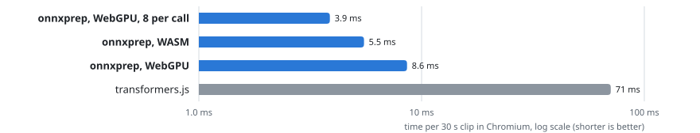

# onnxprep

[](https://github.com/djcopp/onnxprep/actions/workflows/ci.yml)
[](LICENSE)


Whisper's audio preprocessing as one 0.7 MB ONNX file. Raw 16 kHz samples go in, and encoder-ready
log-mel features come out, in any ONNX runtime: the browser on WebGPU or WASM, mobile, or onnxruntime from
Python, C#, Java, Rust or C++.

In the browser it is **13 to 18 times faster than transformers.js**, with the same output to within 5e-5.

**[Try it in your browser](https://djcopp.github.io/onnxprep/)**

<picture>
  <source media="(prefers-color-scheme: dark)" srcset="docs/img/browser-dark.svg">
  
</picture>

## Quick start

### In the browser

Download a prebuilt model from the [latest release](https://github.com/djcopp/onnxprep/releases/latest) and
run it with onnxruntime-web. No Python needed.

```js
import * as ort from "onnxruntime-web/webgpu";

const session = await ort.InferenceSession.create("whisper_frontend_80.onnx", {
  executionProviders: ["webgpu", "wasm"],
});

// pcm: Float32Array of mono 16 kHz samples, any length (padded or trimmed to 30 s)
const { input_features } = await session.run({ audio: new ort.Tensor("float32", pcm, [pcm.length]) });
// input_features: [1, 80, 3000], ready for the Whisper encoder
```

### In Python

```bash
pip install "onnxprep[runtime] @ git+https://github.com/djcopp/onnxprep"
```

```python
import numpy as np
import onnxruntime as ort
from onnxprep.audio import whisper_log_mel

session = ort.InferenceSession(whisper_log_mel(n_mels=80).SerializeToString())
audio = np.zeros(16_000 * 5, np.float32)  # mono 16 kHz
features = session.run(None, {"audio": audio})[0]  # (1, 80, 3000)
```

### From the command line

```bash
onnxprep whisper -o whisper_frontend.onnx                      # 80 mel bins, one clip per call
onnxprep whisper --mels 128 --batch -o whisper_frontend.onnx   # large-v3 and turbo, many clips per call
```

## Models

Each release ships these, built from the code at that tag:

| file | for | input | output |
|---|---|---|---|
| `whisper_frontend_80.onnx` | Whisper tiny to large-v2 | `audio` float32 `[samples]` | `[1, 80, 3000]` |
| `whisper_frontend_128.onnx` | Whisper large-v3, turbo | `audio` float32 `[samples]` | `[1, 128, 3000]` |
| `whisper_frontend_80_batch.onnx` | Whisper tiny to large-v2 | `audio` float32 `[batch, samples]` | `[batch, 80, 3000]` |
| `whisper_frontend_128_batch.onnx` | Whisper large-v3, turbo | `audio` float32 `[batch, samples]` | `[batch, 128, 3000]` |

Audio is mono 16 kHz in the range -1 to 1, and is zero-padded or trimmed to Whisper's 30 s window. In a
batch, every row has the same length, so pad shorter clips with zeros. The models use opset 17 and only
standard operators (opset 17, IR version 8), so they load in onnxruntime 1.14 and later and in
onnxruntime-web.

`whisper_log_mel()` takes the same options as keyword arguments, plus `static_input=True` (a fixed
480,000-sample input, which lets CoreML run 16 of 18 nodes on the GPU) and `stft="native"` (see below).

## Accuracy

Tested against Hugging Face's `WhisperFeatureExtractor`, which matches OpenAI's reference code, on clips
from 0.37 s to 41.5 s:

| mel bins | largest difference vs Hugging Face (numpy) | vs Hugging Face (torch) | vs transformers.js |
|---|---|---|---|
| 80 | 6e-6 | 8e-6 | 1.4e-5 to 4.7e-5 |
| 128 | 1.5e-5 | 2e-5 | |

The features range from about -1 to 1, so these differences are float32 rounding.

## Performance

**Browser** (Chromium, Apple M5, onnxruntime-web 1.30, transformers.js 4.3.2, 30 s clips):

| implementation | ms per clip | vs transformers.js |
|---|---:|---:|
| transformers.js | 70.7 | 1× |
| onnxprep, WebGPU | 8.6 | 8× |
| onnxprep, WASM (10 threads) | 5.5 | 13× |
| onnxprep, WebGPU, 8 clips per call | 3.9 | 18× |

**Native** (Apple M5, onnxruntime 1.32):

| implementation | ms per clip |
|---|---:|
| Hugging Face, PyTorch CPU | 1.4 |
| onnxprep, CPU | 2.9 |
| onnxprep, CoreML | 4.5 |
| Hugging Face, numpy | 10.7 |

On a desktop that already has PyTorch, its FFT-based extractor is faster. onnxprep is for the places PyTorch
isn't: browsers, phones, and services written in other languages.

`scripts/browser_bench.py` and `scripts/benchmark.py` reproduce these numbers.

## How it works

<picture>
  <source media="(prefers-color-scheme: dark)" srcset="docs/img/pipeline-dark.svg">
  
</picture>

The short-time Fourier transform is written as a 1-D convolution: 402 kernels (the real and imaginary parts
of 201 windowed DFT basis vectors), applied with a stride of 160 samples. `Conv` is the most optimised
operator in every ONNX backend, so the whole graph stays on the GPU. ONNX's own `STFT` operator is missing
from most GPU backends, which then run it on the CPU. It is also about 25 times slower on CPU and 100 times
less precise, so it is available as `stft="native"` but not used by default.

## Roadmap

- Speech front ends for other models (Wav2Vec2, Parakeet, Silero VAD)
- Post-processing: CTC greedy decoding, softmax and top-k
- `onnxprep fuse`: attach a front end to an existing model, giving one file from raw audio to output

## Development

```bash
uv sync
uv run pytest
uv run ruff check . && uv run ruff format --check .
uv run python scripts/benchmark.py --json docs/benchmark.json
uv run python scripts/browser_bench.py --json docs/browser.json   # needs: uv run playwright install chromium
uv run python scripts/figures.py
```

Building onnxprep turned up a bug in onnxruntime's CoreML provider, which is fixed in
[microsoft/onnxruntime#34275](https://github.com/microsoft/onnxruntime/pull/34275).

## Licence

MIT
